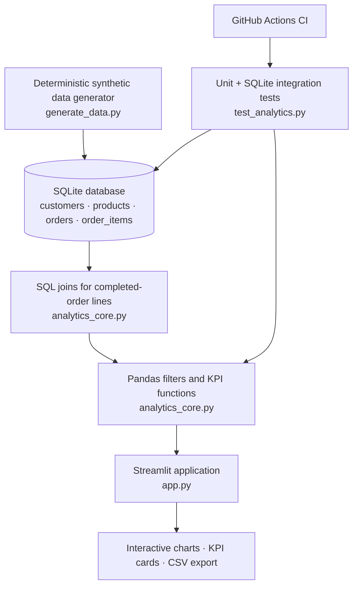
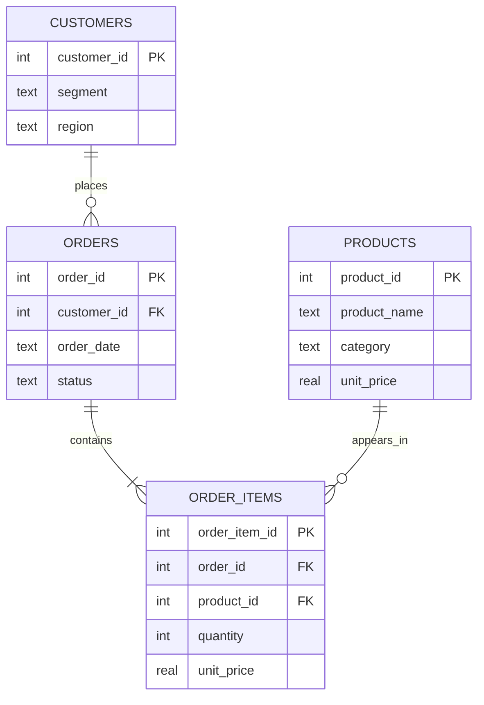

# Retail Intelligence | SQL Business Analytics Dashboard

**An interactive, tested business intelligence portfolio project built with SQL, Python, Pandas, SQLite, and Streamlit.**

[**Launch the live dashboard**](https://nafim-sql-analytics.streamlit.app/) · [**View source code**](https://github.com/mdnafimalam/mdnafimalam/tree/main/projects/sql-business-analytics) · [**View automated tests**](https://github.com/mdnafimalam/mdnafimalam/actions/workflows/sql-dashboard-tests.yml)

> **Data transparency:** Every transaction, customer, and product in this project is **synthetic** and generated with a fixed random seed. The analysis demonstrates technical and business-analytics skills; it does **not** describe a real retailer or real customers.

## Executive summary

Retail teams need to understand where revenue comes from, which products and regions perform best, and whether customers return. This project turns a normalized SQLite sales database into a multi-view business intelligence application with interactive filtering, explainable KPIs, and downloadable reports.

**My contribution:** Designed the relational data model and repeatable data generator; implemented SQL joins and aggregations; built an interactive Streamlit interface; separated calculations into testable Python functions; and configured automated testing in GitHub Actions.

### Business questions answered

1. How much revenue did completed orders generate, and how does it change over time?
2. Which product categories, products, and regions contribute most to revenue?
3. How do customer segments differ in average order value and revenue per customer?
4. What share of customers placed multiple completed orders within the selected filters?
5. Can users trust the figures? Are invalid line items or broken database relationships detected?

## Dashboard capabilities

| View | Key capabilities |
| --- | --- |
| **Executive Overview** | Revenue, completed orders, average order value, unique customers, units sold, revenue per customer, leading-category share, monthly revenue, daily revenue with a 7-day moving average, and descriptive highlights |
| **Sales Performance** | Revenue by region, top products, category-by-region revenue matrix, and product performance table |
| **Customer Insights** | Active customers, repeat customers, repeat-customer share, segment revenue, regional customer counts, and segment-level KPI table |
| **Reports & Data Quality** | Missing-field and negative-revenue indicators, detailed filtered transaction lines, and CSV export |

**Global filters:** Inclusive order-date range, product category, region, and customer segment. Filters apply across all four views.

**Period comparison:** Revenue and order-count deltas compare the selected period against the immediately preceding period of equal length **when data exists**. A missing prior period is shown as unavailable, not as zero growth.

## Architecture



### Relational data model



The data generator creates **250 synthetic customers, 12 products, and 1,500 orders** spanning 2025–2026. Some orders are canceled. Revenue calculations include **completed orders only**; order-item prices are recorded separately from current product-list prices.

### Metric definitions

| KPI | Calculation |
| --- | --- |
| Revenue | Sum of `quantity × unit_price` for completed order lines |
| Completed orders | Distinct `order_id` in the filtered completed-order lines |
| Average order value (AOV) | Revenue ÷ distinct completed orders |
| Unique customers | Distinct `customer_id` in the filtered sales |
| Units sold | Sum of order-line quantities |
| Revenue per customer | Revenue ÷ unique customers |
| Repeat-customer share | Customers with more than one distinct completed order ÷ unique customers |
| Top-category share | Highest category revenue ÷ total filtered revenue |

**Important analytical nuance:** One order may contain multiple items. Order counts use distinct order IDs to avoid overcounting. When a category filter is active, revenue and AOV reflect **selected order lines**, not necessarily the full value of each matching order. Repeat-customer measures are calculated within the selected filters, not as a lifetime retention rate.

## Mini case study: Exploring sales performance

**Scenario:** A fictional retail manager wants to identify revenue concentration and compare performance across product categories and regions.

**Approach:**
1. Select a date window and relevant regions in the dashboard sidebar.
2. Review revenue, order volume, AOV, and category contribution in **Executive Overview**.
3. Use **Sales Performance** to compare products and category-by-region revenue.
4. Open **Customer Insights** to inspect segment-level purchasing behavior.
5. Export filtered order lines for follow-up analysis.

**Illustrative observation:** In one filtered dashboard view, the synthetic dataset displayed **$108,401.12 revenue**, **1,000 completed orders**, **$108.40 AOV**, and a **50.7% leading-category revenue share**. These values depend on the selected filters and are **not** company performance claims.

**Business interpretation:** A large category share may justify a closer look at product concentration, while regional and segment breakdowns can suggest where to investigate differences. These are **hypotheses**, not causal findings or validated recommendations. Real-world decisions would require actual transaction data, costs, returns, inventory, and external context.

## Testing and quality assurance

The production dashboard uses the same functions tested in `analytics_core.py`. The project includes **13 automated unit and integration tests** in `test_analytics.py`, covering:

- Revenue, order count, AOV, units, and category-share calculations
- Unique customers, repeat customers, and revenue-per-customer calculations
- Inclusive date ranges, combined filters, empty selections, and invalid ranges
- Missing required fields, invalid quantities, negative revenue, and line-total mismatches
- Generated SQLite schema, completed-only order selection, independent SQL revenue reconciliation, and foreign-key integrity

**Continuous integration:** [SQL Dashboard Tests](https://github.com/mdnafimalam/mdnafimalam/actions/workflows/sql-dashboard-tests.yml) runs on relevant pushes and pull requests using Python 3.12. Two successful workflow runs were verified in GitHub Actions during project development; consult the linked workflow for the latest status.

## Run locally

**Prerequisites:** Python 3.10+ and Git. Python 3.12 is used in CI.

```bash
git clone https://github.com/mdnafimalam/mdnafimalam.git
cd mdnafimalam/projects/sql-business-analytics
python -m pip install -r requirements.txt
python generate_data.py
python -m streamlit run app.py
```

On Windows, if `python` is not recognized, use `py` in each command:

```powershell
py -m pip install -r requirements.txt
py generate_data.py
py -m streamlit run app.py
```

Run the tests:

```bash
python -m unittest discover -v -p "test_*.py"
```

On Windows, use `py -m unittest discover -v -p "test_*.py"`.

The test suite creates its own temporary database and does **not** overwrite the local dashboard database. The hosted Streamlit app automatically generates the demonstration database if one is not present.

## Repository guide

```text
projects/sql-business-analytics/
├── app.py                 # Streamlit interface and navigation
├── analytics_core.py      # Shared SQL loading, filters, KPIs, validation
├── analytics.sql          # Standalone analytical SQL examples
├── generate_data.py       # Deterministic synthetic SQLite dataset
├── test_analytics.py      # 13 automated tests
├── requirements.txt       # Python dependencies
├── .gitignore             # Excludes generated local database
└── README.md              # Project documentation

.github/workflows/sql-dashboard-tests.yml  # CI workflow (repository root)
```

**SQL concepts demonstrated:** relational modeling, primary and foreign keys, `JOIN`, `GROUP BY`, `COUNT(DISTINCT)`, `SUM`, `ROUND`, common table expressions, and date-based aggregation.

## Screenshots

The live app is the best way to explore the dashboard. Screenshots of **Executive Overview**, **Sales Performance**, **Customer Insights**, and **Reports & Data Quality** can be added under `assets/` after capturing and reviewing them. No screenshot is embedded here until the actual image files are committed.

## Limitations and roadmap

- Synthetic data only; no production integrations or actual business results.
- No cost of goods sold, margins, refunds, shipping, taxes, discounts, or inventory modeling.
- Repeat-customer share is not a cohort retention or customer-lifetime-value model.
- Current period-over-period comparisons require available preceding-period records.
- Potential next steps: actual dashboard screenshots, additional edge-case tests, customer cohorts, inventory/margin modeling, and optional interactive chart drilldowns.

## Author

**Md. Nafim Alam** · Management Information Systems · Emporia State University

Built as a portfolio demonstration of **SQL, Python, data analysis, business intelligence, testing, and deployment**.

**[Explore the live Retail Intelligence dashboard](https://nafim-sql-analytics.streamlit.app/)**
